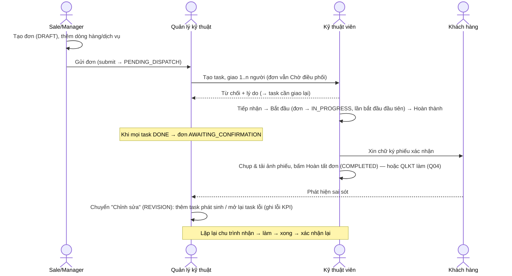
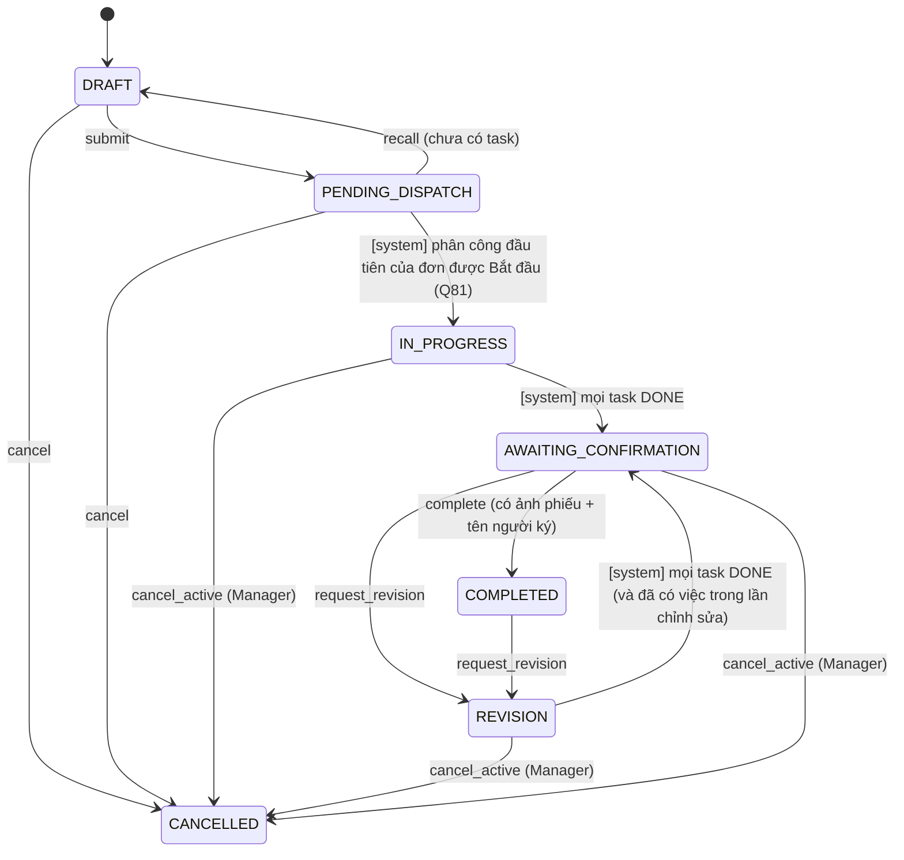
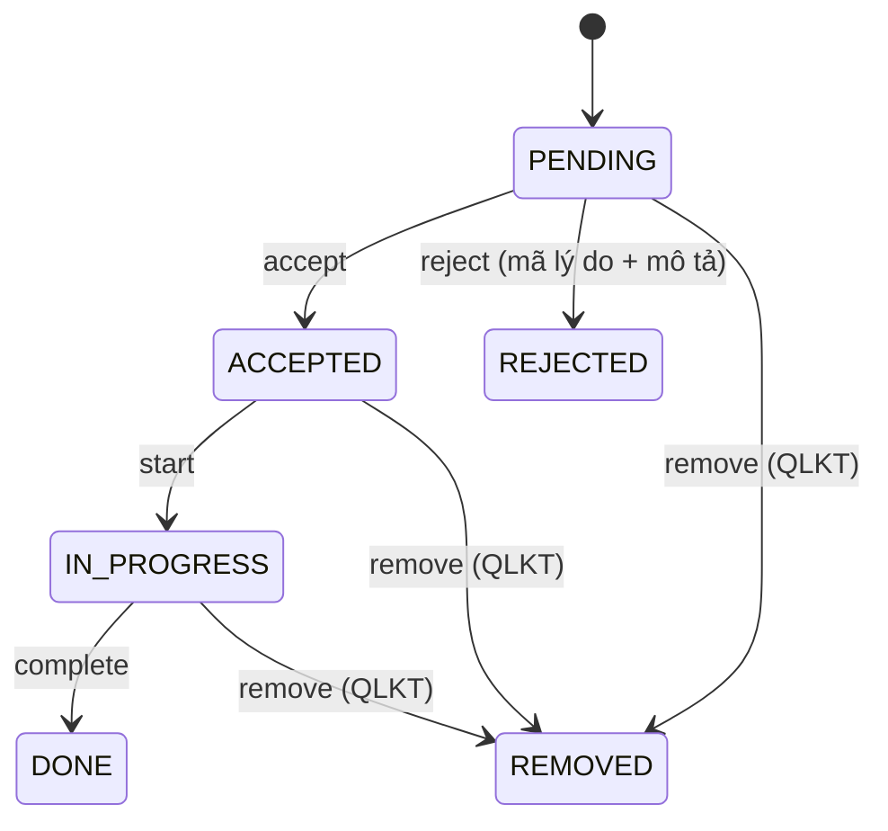

# Workflows — giải thích cho người đọc

> Nguồn sự thật là `spec/state_machines.yaml`. File này chỉ diễn giải; nếu khác nhau, YAML đúng.

## 1. Luồng tổng thể

## 2. Đơn hàng

Điểm cần lưu ý:
- **Chuyển "system"** không có API riêng; được kích hoạt bên trong cùng transaction của lệnh gây ra nó (tạo task, hoàn thành assignment, huỷ task…). Hàm `reevaluate_order(order)` là nơi duy nhất quyết định các chuyển này — **trừ `start_dispatch`**, hiệu ứng `fire_order_start_dispatch_if_first_start` riêng, gắn trong lệnh `assignment.start` (không qua `reevaluate_order`).
- **Đơn hàng IN_PROGRESS ≠ Task/Assignment IN_PROGRESS** (dễ nhầm, 3 chữ "Đang thực hiện" ở 3 tầng khác nhau): đơn chỉ chuyển IN_PROGRESS khi có **ít nhất 1 phân công** của đơn đó thật sự Bắt đầu (`assignment.start`) — chỉ giao task/giao người thôi (task vẫn "Chờ tiếp nhận") KHÔNG làm đơn đổi trạng thái (Q81, chốt 2026-10-15; trước đó đơn đổi ngay lúc tạo task đầu tiên — đã đổi lại theo yêu cầu chủ dự án).
- Khi vào REVISION mà Quản lý kỹ thuật chưa thêm/mở lại task nào, đơn **không** tự nhảy về AWAITING_CONFIRMATION (guard `revision_has_work_if_revision`).
- Ảnh phiếu xác nhận gắn với `revision_no`; sau mỗi lần chỉnh sửa phải có ảnh xác nhận mới.

## 3. Đầu việc (Task) — trạng thái suy ra
Task không có lệnh "đổi trạng thái" trực tiếp. Trạng thái tính từ các assignment **đang hoạt động** (chu kỳ hiện tại, không REJECTED/REMOVED), theo thứ tự ưu tiên:

| # | Điều kiện | Trạng thái |
|---|---|---|
| 1 | Đã huỷ | CANCELLED |
| 2 | Không còn ai đang được giao | NEEDS_ASSIGNEE (cần giao lại — báo đỏ cho QLKT) |
| 3 | Tất cả DONE | DONE |
| 4 | Có ít nhất 1 người IN_PROGRESS hoặc DONE | IN_PROGRESS |
| 5 | Có người còn PENDING | PENDING_ACCEPTANCE |
| 6 | Còn lại (tất cả ACCEPTED) | ACCEPTED |

"Task hoàn thành khi tất cả nhân viên được giao đều báo hoàn thành" = dòng 3. Người đã từ chối/bị gỡ không tính.

**Mở lại (reopen)** — chỉ khi đơn ở REVISION: `cycle += 1`; các assignment chu kỳ cũ giữ nguyên (lịch sử); tạo `defect_records` cho từng người đã DONE ở chu kỳ cũ; tạo assignment PENDING mới cho người được chọn (người cũ hoặc mới).

## 4. Phân công (Assignment)

- Chỉ chính người được giao mới accept/reject/start/complete. QLKT không làm thay (❓ xem OPEN_QUESTIONS).
- Đã tiếp nhận thì không từ chối được nữa — phải liên hệ QLKT để gỡ.
- Không có đường quay lui từ DONE; sai sót xử lý bằng Chỉnh sửa đơn + reopen.

## 5. Tác dụng phụ (effects)
| Effect | Ý nghĩa |
|---|---|
| audit | ghi 1 dòng `audit_events` (from/to, actor, lý do) |
| notify_* | tạo `notifications` cho nhóm người tương ứng (chi tiết §5.1) |
| fire_order_reevaluate | gọi `reevaluate_order` trong cùng transaction |
| record_defect_for_previous_cycle_assignees | tạo `defect_records` |
| cancel_open_tasks | huỷ task chưa DONE và gỡ các assignment mở |

### 5.1 Thông báo (notify_*) — ai nhận khi nào
In-app (chuông) và Web Push dùng **chung một nguồn**: cứ có dòng `notifications` mới (`recipient_id`) là cả 2 kênh cùng bắn cho người đó (`backend/app/modules/notifications/realtime.py`). Không có kênh riêng, không có luật lọc thêm — nhận notify nghĩa là cũng nhận push.

| Hành động (ai bấm / hệ thống) | Lệnh (`spec/state_machines.yaml`) | Ai nhận |
|---|---|---|
| Sale/Manager **gửi đơn** | `order.submit` | Mọi **TECH_LEAD** đang active |
| Hệ thống: đơn **Chờ điều phối → Đang thực hiện** (có assignment active đầu tiên) | `order.start_dispatch` | **Người tạo đơn** + mọi TECH_LEAD active *(đổi 2026-10-21 — trước đó không báo ai)* |
| Hệ thống: đơn **Đang thực hiện → Chờ điều phối** (mất hết assignment active — bị từ chối/gỡ hết) | `order.undispatch` | **Người tạo đơn** + mọi TECH_LEAD active *(đổi 2026-10-21 — trước đó không báo ai)* |
| Hệ thống: **mọi task đã DONE → Chờ KH xác nhận** | `order.all_tasks_done` | **Người tạo đơn** + mọi TECH_LEAD active |
| QLKT/Sale **xác nhận khách ký → Hoàn tất** | `order.complete` | **Người tạo đơn** + mọi TECH_LEAD active *(đổi 2026-10-21 — trước đó chỉ người tạo đơn)* |
| QLKT **yêu cầu chỉnh sửa** | `order.request_revision` | Chỉ **người tạo đơn** |
| QLKT **gỡ hết assignment đang mở** (huỷ active) | `order.cancel_active` | Các KTV bị gỡ |
| QLKT **tạo đầu việc + giao người** | `task.create` | Chỉ các **KTV được giao** |
| QLKT **sửa** đầu việc | `task.update` | KTV đang hoạt động ở chu kỳ hiện tại |
| QLKT **thêm người** vào task | `task.add_assignee` | Chỉ người vừa thêm |
| QLKT **mở lại** task | `task.reopen` | KTV được giao lại ở chu kỳ mới |
| QLKT **huỷ** task | `task.cancel` | KTV đang có assignment hoạt động bị gỡ |
| KTV **từ chối** đầu việc | `assignment.reject` | Mọi TECH_LEAD active |
| KTV **hoàn thành** đầu việc, khiến task đạt `DONE` | `assignment.complete` | Mọi TECH_LEAD active (chỉ khi task đạt `DONE`) |
| QLKT **gỡ 1 người** khỏi đầu việc | `assignment.remove` | Đúng người bị gỡ |

**MANAGER không có kênh thông báo riêng** — không hiệu ứng nào trong hệ thống nhắm đến role này. MANAGER chỉ nhận được khi trùng vai (cũng có role TECH_LEAD) hoặc chính là người tạo/gửi đơn đó (`order.created_by`, vì MANAGER cũng có `order.create`/`order.submit: all` — `spec/permissions.yaml`).

## 6. Đồng thời (concurrency)
Mọi lệnh: `BEGIN` → `SELECT … FROM orders WHERE id = :id FOR UPDATE` (khoá đơn gốc, kể cả khi lệnh nhắm vào assignment) → kiểm tra `version` client gửi → áp dụng → `COMMIT`. Sai version → 409 `STALE_VERSION`, client tải lại.
